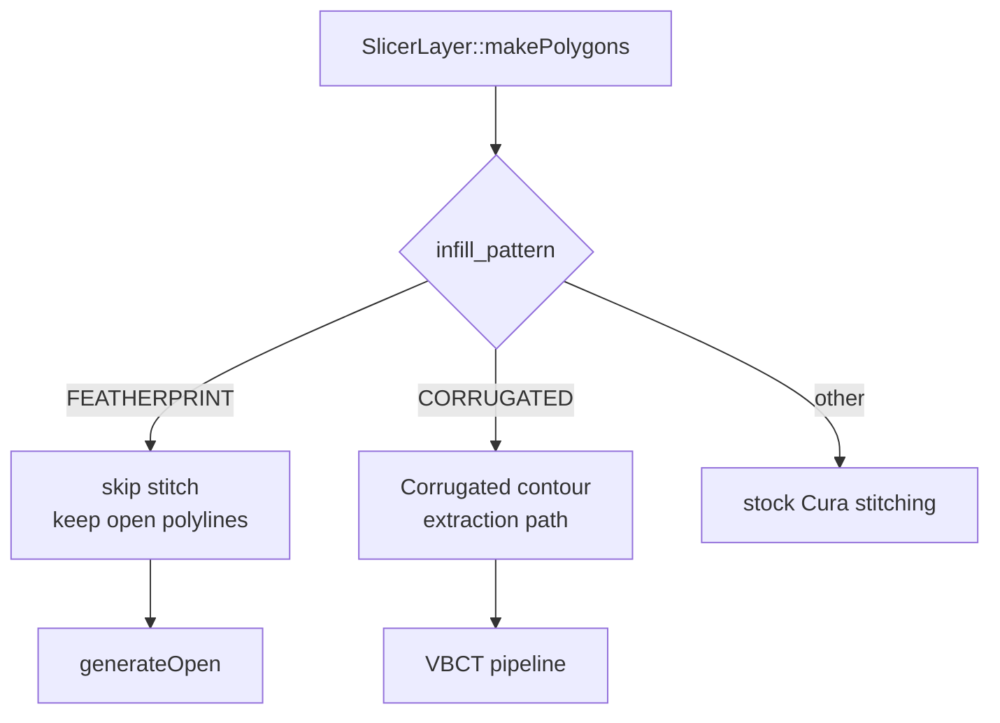
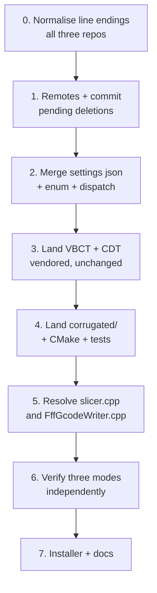

# FeatherPrint Unification Plan

2026-09-17 · @Someone

> **Status, 2026-10-07: merge complete. This document is now a historical record; the body below is unchanged.**
>
> - Steps 0-7 landed on `featherprint-5.13` between 17 and 18 Sep 2026: `.gitattributes` (`495bd0245`), settings and dispatch (`6c5aefd0a`), VBCT + CDT vendored (`726b919d8`), Corrugated adapter, Wall Strip and tests (`342f8cd57`), `slicer.cpp`/`FffGcodeWriter.cpp` wiring (`00c430c15`), and the v1.0.0 installer (`c550e12dc`). Released as v1.0.0; current release v1.1.1.
> - Decisions taken: VBCT stays **vendored** (`src/vbct/VENDORED.md`); Corrugated landed as step commits, not a graft of its 50-commit history; the two **spec lineages stay separate** (FeatherPrint REV 4.12+ points to Corrugated's own spec); the two Cowork project folders were **not merged**.
> - Still open from this plan: the "Remotes" risk. On 2026-10-07 the old Corrugated checkout still had only the Ultimaker upstream remote, so its pre-merge history exists only on local disk. VBCT Cpp's remote was not checked. Corrugated's own unbuilt features (spec §6) carry on as open work in that project.
> - Current FeatherPrint open items: spec REV 4.14, Open Items table. Repo orientation: the project's `Self-Reference/` and this repo's `CLAUDE.md`.

## Purpose and scope

This plans the merge of three separate working trees into one FeatherPrint codebase. Two are CuraEngine 5.13 forks — FeatherPrint and FeatherPrint Corrugated — and the third, VBCT Cpp, is the standalone C++ algorithm library that Corrugated vendors.

Two decisions are settled and constrain everything below.

- **One unified codebase.** FeatherPrint becomes the single repository. The other two trees stop being independent projects.
- **Two separate modes, not one composed feature.** The conformal geodetic skin generator and the corrugated wall-to-wall generator remain mutually exclusive `infill_pattern` values. Neither runs inside the other, and no slice is ever processed by both.

That second decision is the load-bearing one. The two generators assume incompatible input geometry: FeatherPrint works on a single manifold surface and deliberately suppresses the slicer's polygon stitching so open boundaries survive, while Corrugated needs closed shelled geometry that stitches into conventional inner and outer perimeter walls. Keeping them as exclusive modes means the conflicting demands on shared CuraEngine code can be resolved by dispatch on the active mode rather than by reconciling the two geometric models.

## Target end state

One repository — `github.com/Rszalay/FeatherPrint`, branch `featherprint-5.13` — containing both generators, the shared VBCT library, and one settings definition that registers both modes.

The unified source layout, all of which already exists in one tree or another:

| Path | Origin | Role after merge |
| --- | --- | --- |
| `include/featherprint/`, `src/featherprint/` | FeatherPrint | Conformal geodetic skin generator (`FEATHERPRINT` mode) |
| `include/corrugated/`, `src/corrugated/` | Corrugated | Adapter, corrugation anchor, wall strip (`CORRUGATED` mode) |
| `src/vbct/` | Corrugated's vendored copy | Shared 10-stage algorithm library |
| `include/third_party/CDT/` | Corrugated | Triangulation dependency of VBCT (MPL-2.0) |
| `packaging/fdmprinter.def.json` | Corrugated's copy | Settings for both modes — already a superset |
| `packaging/FeatherPrint.iss` | FeatherPrint | Installer |
| `tests/` | Both | `VbctAdapterTest`, `WallStripTest` plus FeatherPrint's own |

What happens to each current tree:

- **FeatherPrint** — survives as the unified repository. Everything merges into it.
- **FeatherPrint Corrugated** — its code moves in and the checkout retires. Its Cowork project folder stays as the historical home of its specs, lessons learned and as-builts.
- **VBCT Cpp** — **does not retire.** It keeps its own repository, CMake build and Catch2 suite, and stays the place where stage 1–9 algorithm work is developed and validated before being ported in. Section 5 covers why.

The open structural question is whether VBCT Cpp should gain a git remote and be consumed as a submodule rather than a vendored copy. Vendoring is what exists today and what the port-by-diff convention is built around.

## Current state of the three trees

All three working trees are functionally clean — no uncommitted source changes anywhere. Two of the three have no publishable remote.

|  | FeatherPrint | VBCT Cpp | FeatherPrint Corrugated |
| --- | --- | --- | --- |
| Checkout | `FeatherPrint/FeatherPrint` | repo root | `FeatherPrint Corrugated/FeatherPrint Corrugated` |
| Branch | `featherprint-5.13` | `master` | `featherprint-corrugated-5.13` |
| HEAD | `cc66f84fe` | `41c075a` | `0d573b80b` |
| Remote | `Rszalay/FeatherPrint`, in sync | **none** | `Ultimaker/CuraEngine` upstream only |
| Base | CuraEngine 5.13 fork | standalone library | CuraEngine 5.13 fork |
| Own source | `FeatherPrintGenerator.h/.cpp` (248 KB) | `src/vbct/` — 5,810 lines, stages 1–10 | `corrugated/` + vendored `src/vbct/` + CDT |
| Commits vs baseline | 32 | — | 50 (+42,295 lines) |
| Spec revision | REV 4.11, 16 Aug | REV 2.3, 14 Sep | REV 3.6, 17 Sep |
| Tests | none of its own | 36 cases / 65,260 assertions, all pass | `VbctAdapterTest` 62 cases, 61 pass |
| Working tree | 32 deleted spec files (intentional), 1 untracked `Claude.md` | clean | clean |

Neither engine fork contains any trace of the other. FeatherPrint has no `vbct` or `corrugated` path; Corrugated has no `featherprint` source directory. The one exception is settings — see section 7.

The single known test failure in `VbctAdapterTest` (`ChainSwapLeftRightHandlesBothIdentitySwapsWithNoThrashing`) is pre-existing and recorded as unrelated in every as-built since it appeared. It is a pre-existing condition to carry across, not a merge blocker.

## Shared baseline and the collision surface

The two forks share no git history — neither repository can resolve the other's HEAD — but they sit on content-identical CuraEngine sources. Comparing every blob in both baseline branches: 620 files versus 612, and **every C++ source file is bit-identical**. The only baseline differences are FeatherPrint project scaffolding that Corrugated's baseline never had: `AI Primers/`, `packaging/CuraFeather.iss`, `packaging/fdmprinter.def.json`, the deploy scripts, `.gitignore` and `conanfile.py`.

So this is a merge of two disjoint patch sets against the same tree, not a rebase across engine versions. Only seven upstream files are touched by both sides.

| File | FeatherPrint | Corrugated | Conflict type |
| --- | --- | --- | --- |
| `src/slicer.cpp` | +9 / −2 | +408 / −10 | **Semantic** — both edit `makePolygons()` |
| `src/FffGcodeWriter.cpp` | +34 / −1 | +687 / −2 | Textual — different hunks |
| `include/sliceDataStorage.h` | +161 | +10 | Textual — different hunks |
| `CMakeLists.txt` | +1 | +19 | Trivial — both append to `engine_SRCS` |
| `include/settings/EnumSettings.h` | +1 | +1 | Trivial — same hunk, one enumerator each |
| `src/settings/Settings.cpp` | +2 | +2 | Trivial — same hunk, one dispatch case each |
| `packaging/fdmprinter.def.json` | modified | added as new | Already merged — see section 7 |

The four trivial and textual collisions are mechanical. `EnumSettings.h` and `Settings.cpp` land in the same hunk but add independent values — `FEATHERPRINT` and `CORRUGATED` — that simply coexist. `FffGcodeWriter.cpp` and `sliceDataStorage.h` touch different regions of the same files.

`src/slicer.cpp` is the only real contention, and section 6 covers it.

## VBCT: who owns which stage

The vendored copy has diverged from VBCT Cpp in **both directions**, and the split is deliberate rather than drift.

| File | VBCT Cpp | Vendored copy | Ahead |
| --- | --- | --- | --- |
| `stage10.cpp` | 224 lines | 1,182 lines | **Vendored** |
| `stage10.hpp` | baseline | +405 lines | **Vendored** |
| `pipeline.hpp` | 4-arg signature | 18-arg, all defaulted | **Vendored** |
| `stage5.cpp` | 2,458 lines | 2,292 lines | VBCT Cpp — but see below |
| `stage6.cpp` | identical | identical | — |
| `wall_ab_assignment.cpp` | identical | identical | — |

Stage 10 is where corrugation actually happens — Crosshatch, Linked Corrugation Skin, `phase_offset`, `build_domain_events` — and none of it ever existed in VBCT Cpp. It was built directly in the fork and never fed back. The 15 Sep as-built records checking VBCT Cpp explicitly and finding nothing to port.

The `stage5.cpp` gap runs the other way but is not a real lag: the 166-line delta is Correction 2c, the anchored non-VBS collinear cascade, which is present in VBCT Cpp but marked `DISABLED`. Functionally the two copies of stage 5 are in sync.

The extended `pipeline.hpp` signature is backward compatible — every corrugation parameter is defaulted, so VBCT Cpp's own 4-argument call sites still compile against it.

### The convention to preserve

Corrugated's spec §1.2a and `src/vbct/VENDORED.md` already set the rule, and it needs to survive the merge intact: algorithm fixes to stages 1–9 are developed and validated against VBCT Cpp's Catch2 library first, then ported into the engine **by diffing after copy, never by blind-copying** — because the fork-side files carry substantial corrugation-only content a blind copy would destroy.

This is the reason VBCT Cpp does not retire. Its 44 fixtures, 8 diagnostic tools and 65,260 assertions are the only place stage 1–9 changes can be validated in isolation; inside the engine they can only be tested through a full reslice. The practical effect is that "one unified codebase" means one *product* repository, with VBCT Cpp retained as an upstream algorithm workbench.

## Mode separation

Both generators hang off `infill_pattern`, and the two values are exclusive by construction — a mesh is either `featherprint` or `corrugated`, never both. They differ in what they assume the input is.

|  | `FEATHERPRINT` | `CORRUGATED` |
| --- | --- | --- |
| Input geometry | Single manifold surface, may be open | Closed shelled mesh |
| Wall concept | No inner/outer distinction | Conventional inner and outer perimeters |
| Operates on | The perimeter itself | `part.infill_area` after wall generation |
| Needs open polylines | Yes — requires them | No — requires closed polygons |

That last row is the whole conflict, and it lands in one function.

### The `makePolygons()` contention

FeatherPrint's edit gates off `stitch()` and `stitch_extensive()` when the pattern is `FEATHERPRINT`, so open-boundary layers survive as `open_polylines` for `generateOpen()` to handle. It keeps `connectOpenPolylines` at its 0.02 mm threshold so mesh-precision fragments still join, but suppresses `stitch()`, which bridges gaps up to 10 mm and would close the cutouts it depends on.

Corrugated rewrites much of the same function — +408 lines — for its own contour extraction.

Because the modes are exclusive, neither edit needs to accommodate the other. Both are already written as conditionals on the active pattern, and the merge is a matter of making the existing gates mutually exclusive rather than reconciling two geometric models. The verification that matters is that stock Cura patterns still slice unchanged when neither mode is selected — the third branch above.

`FffGcodeWriter.cpp` follows the same shape: FeatherPrint's 34 lines sit in `addMeshLayerToGCode`, Corrugated's 687 in `addMeshPartToGCode` and `processSingleLayerInfill`. Different entry points, same dispatch principle.

## Settings and packaging

**The settings file is already merged.** Corrugated's `packaging/fdmprinter.def.json` is FeatherPrint's file plus 158 lines. Diffing the two produces 158 additions and one removal, and the removal is only `"featherprint": "FeatherPrint"` gaining a trailing comma so `"corrugated": "Corrugated"` could follow it. Both modes are registered as `infill_pattern` options at lines 2249–2250.

It carries all 18 `featherprint_*` keys and all 12 `corrugated_*` keys:

| Mode | Settings |
| --- | --- |
| `featherprint_*` | `helix_angle`, `stringer_count`, `stringer_width`, `line_width`, `lacing_width`, `feature_depth`, `former_enabled`, `former_ramp_layers`, `former_spacing`, `flange_enabled`, `flange_ramp_layers`, `collar_enabled`, `collar_layers`, `punchout_enabled`, `punchout_gap`, `punchout_contour_samples`, `curvature_k_ref`, `force_zhop_height` |
| `corrugated_*` | `stringer_pitch`, `crossover_pitch_mm`, `crosshatch_enabled`, `skin_linked`, `transition_layer_enabled`, `prune_threshold`, `vbs_tolerance`, `chain_junction_merge_angle`, `deminimis_hole_area`, `raw_outline_mode`, `strip_wall_a`, `strip_wall_b` |

The `featherprint_*` keys are currently orphans in Corrugated — nothing in its `src` or `include` reads them. After the merge they become live again. Taking Corrugated's file wholesale is the right move; it is the unified settings definition already.

One caveat worth checking during the merge: Corrugated's copy was taken from FeatherPrint at some point before REV 4.11, so any `featherprint_*` default or tooltip changed since then needs re-checking against FeatherPrint's current file rather than assumed identical.

### Distribution

Only FeatherPrint has an installer — `packaging/FeatherPrint.iss`, shipping as `FeatherPrint-0.9.1-Windows-x64-Setup.exe`, which patches an existing Cura 5.13.x install. Corrugated has no installer and was deployed by copying `CuraEngine.exe` and `fdmprinter.def.json` by hand.

The deploy scripts diverged: `scripts/deploy-test.ps1` by 30 lines, `scripts/restore-dlls.ps1` by 7. These need reconciling into one pair, and FeatherPrint's versions are the ones tied to the installer pipeline documented in its build lessons.

The installer will need a version bump and a settings-page entry for the corrugated mode. `Lessons Learned/installer_distro_lessons_learned.md` in the FeatherPrint project records the non-obvious constraints here — static Arcus linking, DLL exclusions, engine/frontend version locking — and should be read before touching it.

**Update, 2026-09-18 (post-merge, v1.0.0):** a real-print test surfaced that hand-assembling a working `corrugated_*` configuration from scratch is error-prone enough to produce severe visible distortion when a setting is missed — traced to a wrong base quality profile, not a code defect (verified via direct source diff and geometry comparison against Corrugated's own unmodified binary). The installer now also deploys a validated `FeatherPrint Corrugated` `quality_changes` profile pair (`packaging/quality_changes/`) into the user's `%APPDATA%\cura\5.13\quality_changes\`, giving a known-good starting point instead of requiring manual configuration. It deliberately excludes material-physical settings (temperature/flow/fan/retraction) so it layers safely over whatever material profile is already active.

## Pre-merge housekeeping

Five things to settle before any code moves. None is hard; all of them make the merge harder if left.

**1. Line endings.** This is the one that must go first. Corrugated shows 580 modified files and VBCT Cpp shows 5, and every one of them is CRLF-versus-LF noise — verified with `--ignore-cr-at-eol`, which reports zero real content changes in any of the three repos. There is no `.gitattributes` anywhere and `core.autocrlf` is unset. Left as-is, every merge diff will be unreadable and every conflict will look total. Add a `.gitattributes`, renormalise, and commit that as its own step before anything else.

**2. Remotes.** VBCT Cpp has no remote at all — 65,260 assertions of validated algorithm work exist on one disk. Corrugated has only Ultimaker upstream, so its 50 commits are likewise unpushed anywhere. Both need somewhere to live before their history is merged or retired.

**3. FeatherPrint's uncommitted deletions.** 32 spec files and images are deleted but uncommitted, having been archived into `FeatherPrint Spec/FeatherPrint Spec archive.7z`. Plus one untracked `Claude.md`. Intentional, but it should be committed so the tree is genuinely clean going in.

**4. The Claude project knowledge base is stale.** The six docs attached to this project are the Jun–Jul 2026 spec lineage — Flange, Flare and Miter as of the fifth revision, Former still unimplemented. On disk the canonical spec is REV 4.11, more than twenty revisions later. The project has nothing at all about Corrugated or VBCT. Anything reading this project for context is working from a two-month-old picture of one of the three trees.

**5. The read-only convention is now void.** Corrugated's `Instructions/Project Understanding.md` and both projects' `File Folder Permissions.md` state that FeatherPrint and VBCT Cpp are strictly read-only from Corrugated's side, and that "integration happens later, as a separate deliberate step, once this project's own mod is complete." That step is this one. Those instruction files need updating, or the next session will read them and refuse to do the merge.

## Integration sequence

A proposed order, for you to redirect. The principle behind it: normalise first so diffs are readable, land the settings and build scaffolding before any generator code, then bring in the corrugated mode as one unit and verify each mode independently.

| Step | What lands | How it is verified |
| --- | --- | --- |
| 0 | `.gitattributes` and renormalisation | `git status` clean in all three repos |
| 1 | Remotes for VBCT Cpp and Corrugated; FeatherPrint's deletions committed | Everything pushed; nothing uncommitted |
| 2 | Corrugated's `fdmprinter.def.json`, both enum values, both dispatch cases | Engine builds; both patterns appear in Cura's UI |
| 3 | `src/vbct/`, `include/third_party/CDT/`, `VENDORED.md` files | Builds; no behaviour change yet |
| 4 | `include/corrugated/`, `src/corrugated/`, CMake entries, `VbctAdapterTest` + `WallStripTest` | 62 cases, 61 pass — matching the known pre-existing failure |
| 5 | The two contended functions, gated on active mode | Both mode gates provably exclusive |
| 6 | Nothing — verification only | Reslice a known-good part per mode, plus a stock Cura pattern |
| 7 | Installer bump, `Claude.md`, project instructions, spec | Installer patches a clean Cura 5.13.x |

Step 6 is the one worth being strict about. There are three paths to prove, not two: `FEATHERPRINT`, `CORRUGATED`, and stock Cura with neither selected. Good reslice candidates already exist — `FPTF-45 - Body.stl` and `Multi-Domain - Two-Hole.stl` for corrugated, and FeatherPrint's own production test parts for the conformal mode.

Steps 0–4 are additive and low-risk. Step 5 is where judgement is needed, and it is small — two functions.

## Open questions and risks

### Decisions needed

- [ ] **Vendor or submodule for VBCT?** Vendoring is what exists and what the port-by-diff convention assumes. A submodule would make provenance exact but cannot represent the stage-10 divergence, since the fork's copy is genuinely a different file. Recommend staying vendored.
- [ ] **Does git history merge, or do the corrugated commits land as a squash?** The two forks share no ancestry, so a real merge means grafting 50 commits onto an unrelated root. A single well-described commit is simpler but loses the reasoning in those commit messages — which both projects treat as primary documentation.
- [ ] **Where do Corrugated's specs live afterwards?** REV 3.6 is a live document, more current than FeatherPrint's own REV 4.11. One merged spec lineage, or two side by side for two modes?
- [ ] **Do the two Cowork project folders merge too, or only the repositories?** Corrugated has its own Lessons Learned, Self-Reference and as-built series that have no FeatherPrint equivalent.

### Risks

| Risk | Why it matters | Mitigation |
| --- | --- | --- |
| Line-ending noise masks a real conflict | 580 phantom modifications make any conflict look total | Step 0, before anything else |
| VBCT Cpp has no remote | The only copy of the validated algorithm work is on one disk | Step 1, before any merge |
| `stage5.cpp` port lag reappears | The vendored copy already trails by one disabled correction | Re-diff at merge time; record the convention in `Claude.md` |
| Stale `featherprint_*` defaults | Corrugated's settings copy predates REV 4.11 | Diff the `featherprint_*` blocks rather than assuming |
| Instruction files still say read-only | A future session will refuse the merge | Step 7 — or earlier if another session starts work |
| Corrugated's unbuilt features | Glob fallback, N-way hub stitching and the Fuselage cross-section are still open per its §6 | Merging does not close them; carry them forward as open work |

The last one is worth stating plainly: Corrugated's own project intent said integration happens "once this project's own mod is complete," and by its own spec §6 it is not complete. Merging now is a deliberate departure from that plan, which is fine, but the unfinished items travel with it rather than disappearing.
